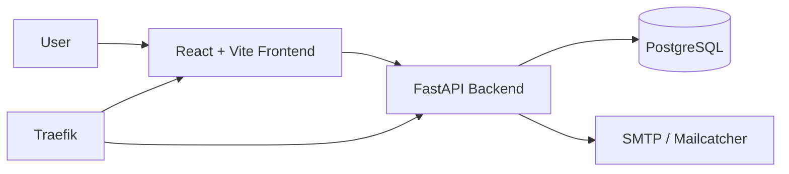

# Full Stack FastAPI Template

## Executive Summary
This repository is a production-ready starter template for building modern web applications with a FastAPI backend, a React/Vite frontend, PostgreSQL, Docker Compose, and optional CI/CD deployment workflows. It is designed to help teams launch secure, maintainable applications quickly while keeping development and deployment workflows simple.

## Problem Statement
Many teams need a solid foundation for:
- secure authentication and user management,
- CRUD-style data APIs,
- a polished frontend experience,
- containerized local development,
- and repeatable deployment to staging and production.

This template provides a well-structured starting point that addresses these needs with minimal setup.

## Architecture Diagram



## Folder Structure
```text
.
├── backend/              # FastAPI application and tests
├── frontend/             # React/Vite application and Playwright tests
├── docs/                 # Project documentation
├── .github/workflows/    # CI/CD workflows
├── compose.yml           # Main Docker Compose file
├── compose.override.yml  # Local development overrides
├── compose.traefik.yml   # Traefik deployment stack
└── deployment.md         # Deployment walkthrough
```

## Technologies
- Backend: FastAPI, SQLModel, Pydantic, JWT, Alembic
- Frontend: React, TypeScript, Vite, TanStack Router, Tailwind CSS
- Database: PostgreSQL
- Containerization: Docker, Docker Compose
- Reverse Proxy: Traefik
- Testing: Pytest, Playwright
- CI/CD: GitHub Actions
- Monitoring: Sentry integration

## Local Development
### Prerequisites
- Docker Desktop or Docker Engine
- Python 3.10+
- Node.js/Bun

### Backend
```bash
cd backend
uv sync
uv run fastapi dev app/main.py
```

### Frontend
```bash
cd frontend
bun install
bun run dev
```

### Full Stack with Docker Compose
```bash
docker compose watch
```

Access points:
- Frontend: http://localhost:5173
- Backend API: http://localhost:8000
- API Docs: http://localhost:8000/docs
- Adminer: http://localhost:8080
- Traefik UI: http://localhost:8090
- Mailcatcher: http://localhost:1080

## Docker
The repository includes Dockerfiles for both the backend and frontend services:
- [backend/Dockerfile](backend/Dockerfile)
- [frontend/Dockerfile](frontend/Dockerfile)

## Docker Compose
The compose stack includes:
- `db` for PostgreSQL
- `backend` for FastAPI
- `frontend` for the React app
- `adminer` for database administration
- `proxy` and `traefik` for routing
- `mailcatcher` for email testing

## AWS ECR
GitHub Actions includes a build workflow that packages the backend and frontend into Docker images and pushes them to Amazon ECR. Configure the following repository variables/secrets:
- `AWS_ACCESS_KEY_ID`
- `AWS_SECRET_ACCESS_KEY`
- `AWS_REGION`
- `ECR_REGISTRY`

## Kubernetes Deployment
Although this repository does not ship a full Kubernetes manifest set yet, the intended architecture is:
- one backend deployment,
- one frontend deployment,
- a PostgreSQL service,
- secrets for runtime configuration,
- and an ingress or load balancer for external access.

## CI/CD with GitHub Actions
The repository includes workflows for:
- building and pushing Docker images,
- deploying to staging,
- deploying to production,
- and running frontend browser tests.

## Configuration
Configuration is driven by environment variables and the `.env` file at the repository root. The backend loads settings from the `.env` file and applies defaults where appropriate.

## Environment Variables
Key variables include:
- `DOMAIN`
- `FRONTEND_HOST`
- `ENVIRONMENT`
- `PROJECT_NAME`
- `SECRET_KEY`
- `FIRST_SUPERUSER`
- `FIRST_SUPERUSER_PASSWORD`
- `POSTGRES_PASSWORD`
- `POSTGRES_DB`
- `POSTGRES_USER`
- `SMTP_HOST`
- `SMTP_USER`
- `SMTP_PASSWORD`
- `EMAILS_FROM_EMAIL`
- `SENTRY_DSN`

## API Endpoints
The backend exposes REST APIs for:
- authentication and token exchange,
- user registration and profile management,
- item CRUD operations,
- password recovery and reset,
- and health checks.

Detailed API documentation is available in [docs/API.md](docs/API.md).

## Security Considerations
- Use strong secrets in staging and production.
- Keep `.env` out of source control.
- Restrict CORS origins to trusted domains.
- Prefer managed databases and secret stores in production.
- Rotate credentials regularly.

## Monitoring
- Sentry is wired into the backend for error reporting.
- Health checks are available through the API.
- Docker logs and Traefik access logs can be used for operational diagnostics.

## Troubleshooting
Common issues:
- Database not ready: wait for PostgreSQL health checks to pass.
- Frontend cannot reach API: verify `VITE_API_URL` and `BACKEND_CORS_ORIGINS`.
- Authentication failures: confirm `SECRET_KEY` and the initial superuser credentials.
- Container build errors: review Docker logs and ensure required files are present.

## Future Roadmap
Planned improvements include:
- full Kubernetes manifests and Helm charts,
- stronger observability with Prometheus/Grafana,
- role-based admin workflows,
- CI/CD environment promotion pipelines,
- and expanded automated tests.

## Documentation Index
- [docs/ARCHITECTURE.md](docs/ARCHITECTURE.md)
- [docs/API.md](docs/API.md)
- [docs/DEPLOYMENT.md](docs/DEPLOYMENT.md)
- [docs/CONTRIBUTING.md](docs/CONTRIBUTING.md)
