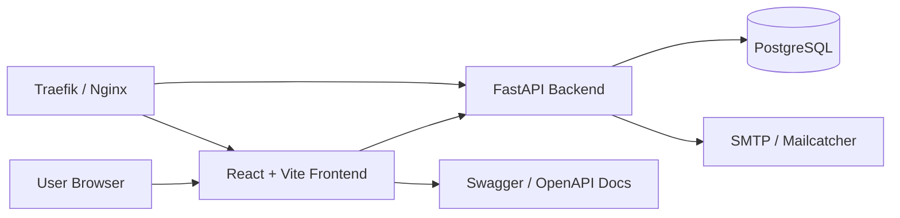

# Architecture

## Executive Summary
This repository provides a full-stack application template built around a FastAPI backend, a React/Vite frontend, PostgreSQL, and Docker-based deployment. The design emphasizes developer productivity, containerization, and simple production deployment behind a reverse proxy.

## Problem Statement
Teams often need a reliable starting point for building internal tools or SaaS-style applications with:
- a secure API layer,
- a modern frontend experience,
- authentication and user management,
- database persistence,
- and repeatable deployments.

This project addresses that by bundling the essential components into a single, documented starter stack.

## High-Level Architecture

## Component Responsibilities
- Frontend: React application for authenticated user workflows, item management, and account settings.
- Backend: FastAPI service exposing REST endpoints, JWT-based authentication, database access, and email utilities.
- Database: PostgreSQL stores users and items.
- Proxy: Traefik terminates traffic and routes requests to the correct service.
- Observability: Sentry integration and health endpoints support monitoring and error tracking.

## Deployment Topologies
### Local Development
- Docker Compose starts the database, backend, frontend, proxy, and mail catcher.
- The frontend is exposed on port 5173 and the API on 8000.

### Production-like Deployment
- Traefik sits in front of the frontend and backend.
- The API and frontend are typically exposed on subdomains such as api.example.com and dashboard.example.com.

## Data Flow
1. A user accesses the frontend.
2. The frontend calls the FastAPI API.
3. The backend authenticates requests using JWTs.
4. The backend reads and writes to PostgreSQL.
5. Email notifications are sent through SMTP or captured by Mailcatcher in development.

## Security Boundaries
- JWT-based authentication.
- CORS configuration for approved origins.
- Environment-based secrets and configuration loading.
- Role-based access for user and admin APIs.

## Extensibility
The structure separates API, core config, database, and routes so additional services, queues, or background workers can be introduced cleanly.
